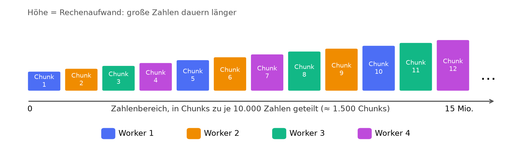
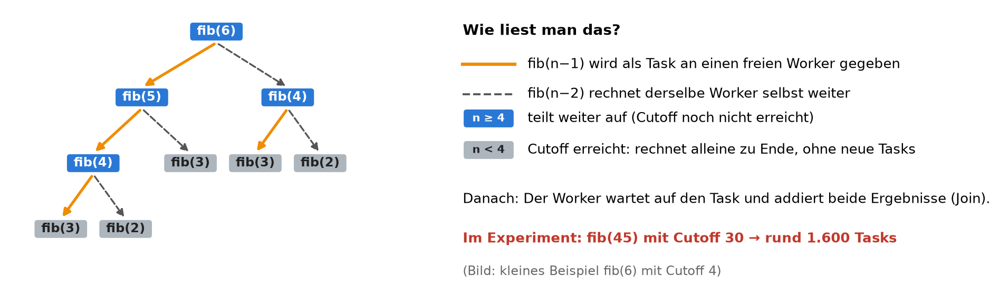
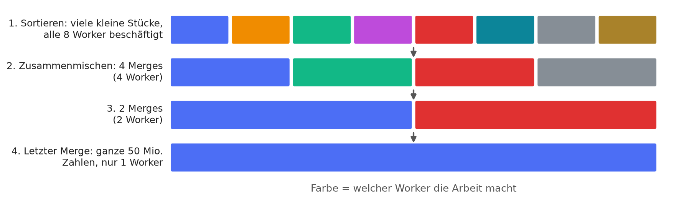
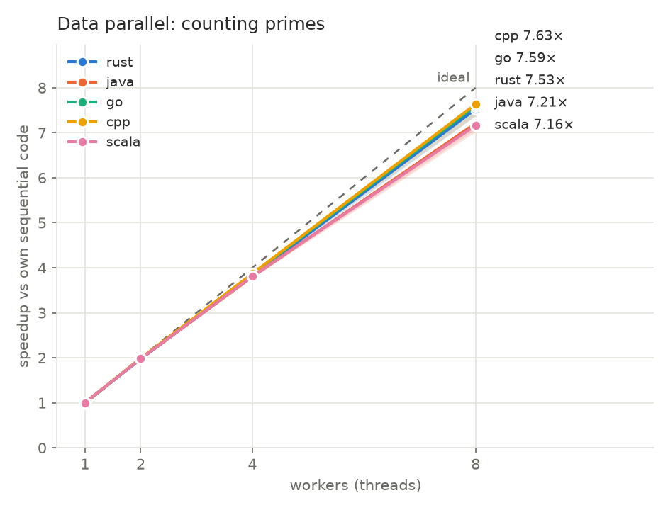
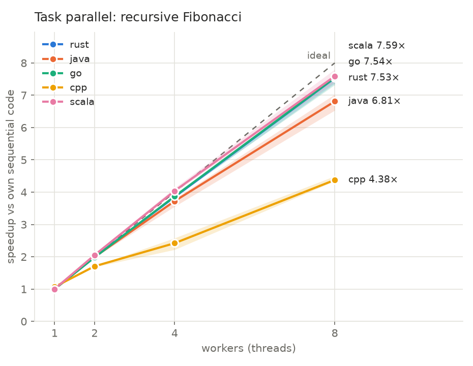
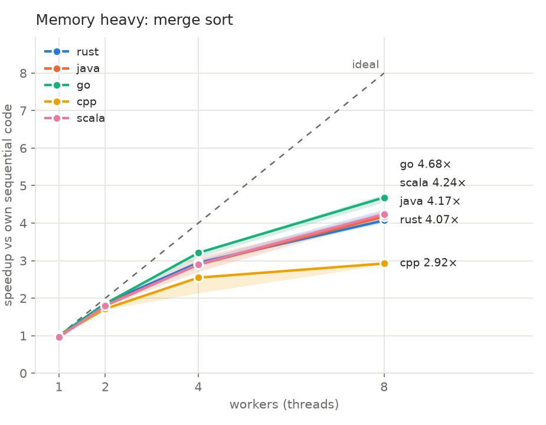
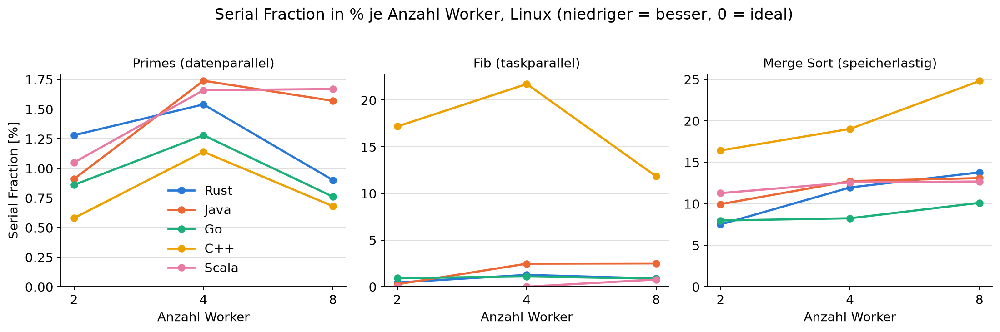
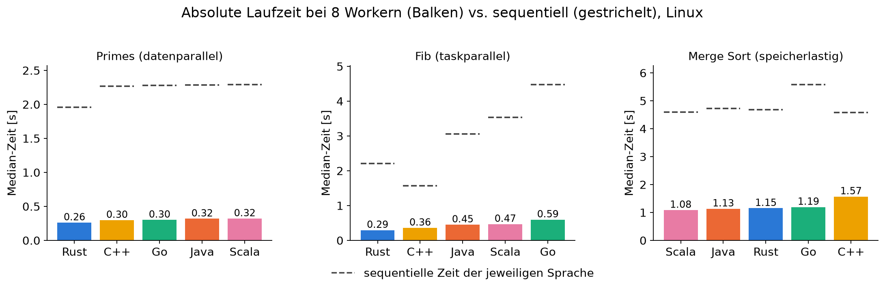
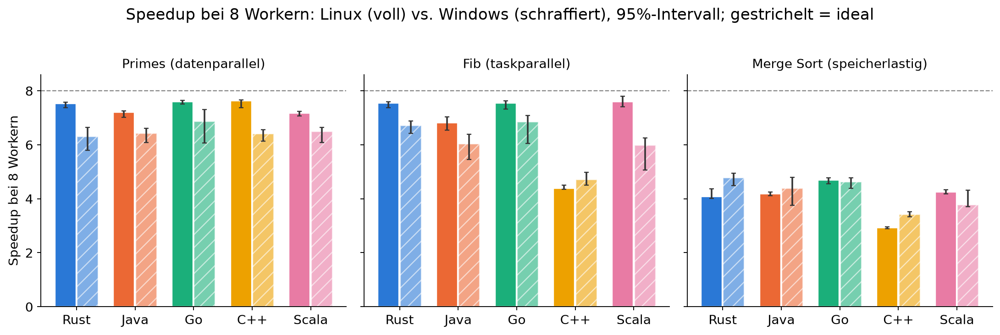

<!-- _class: title -->
<!-- _paginate: false -->
<!-- _header: '' -->
<!-- _footer: '' -->

# Wie gut skaliert Parallelität?

### Ein Multicore-Speedup-Vergleich von Rust, Go, Java, C++ und Scala

Kamilo Knezevic · Stefan Wild
LV Wissenschaftliches Arbeiten und Schreiben

<!--
[Kamilo/Stefan – Begrüßung, ca. 0:30]
Guten Tag, wir stellen unser Experiment zur Frage vor, wie gut fünf Programmiersprachen von mehreren CPU-Kernen profitieren.
Wir teilen uns auf: Teil 1 (Frage, Methode) und Teil 2 (Ergebnisse, Diskussion, Fazit). Je ca. 9-10 Minuten.
-->

---

# Agenda

1. Motivation und Forschungsfrage
2. Methodik: Algorithmen, Sprachen, Messdesign
3. Ergebnisse
4. Diskussion
5. Conclusio

<!--
[ca. 0:30]
Klassischer wissenschaftlicher Aufbau: Frage → Methode → Ergebnisse → Diskussion → Fazit.
Übergabe zwischen Methodik und Ergebnissen.
-->

---

# Motivation

- Taktraten steigen kaum noch, Leistung kommt über **mehr Kerne**
- Aber: 8 Kerne ≠ 8-fache Geschwindigkeit
- Jede Sprache bietet **eigene Parallel-Modelle** mit eigenen Kosten
- Üblicher Vergleich: wer ist *schneller*? Wir fragen: wer **skaliert** besser?

<!--
[ca. 1:00]
Hintergrund: Seit ca. Mitte der 2000er stagniert die Taktfrequenz (Leistungsaufnahme/Hitze), Hersteller setzen auf mehr Kerne. Software muss selbst parallel arbeiten, sonst bleibt Leistung ungenutzt.
Amdahl: Der sequentielle Anteil begrenzt den Speedup. Dazu kommen Overheads (Threads starten, Scheduler, Speicher, Garbage Collection).
Die Sprachen bringen sehr verschiedene Laufzeiten mit: native (Rust, C++), Go mit eigenem Scheduler und GC, JVM (Java, Scala) mit JIT und GC.
Bewusster Fokus: relative Skalierung (jede Sprache gegen ihren EIGENEN sequentiellen Code), nicht nur Rohgeschwindigkeit. Rohgeschwindigkeit zeigen wir später trotzdem, weil man beides getrennt betrachten muss.
-->

---

# Forschungsfrage

**Wie stark profitieren Rust, Go, Java, C++ und Scala vom Wechsel von sequentiellem zu parallelem Code auf mehreren Kernen, und hängt das von der Art des Problems ab?**

1. Wie skaliert jede Sprache bei **Rechenarbeit, Tasks und Speicherlast**?
2. **Wo geht Effizienz verloren** (sequentieller Anteil, Overhead, Speicher)?
3. Ist die Sprache mit dem **besten Speedup** auch die **schnellste**?

<!--
[ca. 1:30]
Forschungsfrage in Ruhe vorlesen, dann die drei Unterfragen. Sie entsprechen den Ergebnisfolien: 1 → Primes/Fib/Msort, 2 → Serial Fraction, 3 → absolute Laufzeit.
Zwei Teile der Frage: (1) Wie stark profitiert jede Sprache, gemessen als Speedup gegen den EIGENEN sequentiellen Code. (2) Ändert sich das mit dem Problemtyp: reine Rechenarbeit, Tasks mit Rekursion, speicherlastige Arbeit.
Zusätzlich schauen wir uns die absolute Laufzeit an, weil ein hoher Speedup allein nicht sagt, welche Sprache schnell ist (ein langsamer sequentieller Code macht einen hohen Speedup leichter). Dazu kommen wir bei den Ergebnissen.
Effizienz = Speedup / Anzahl Worker, bei 8 Workern ist 100 % ein Speedup von 8.
-->

---

# Drei Algorithmen

| | Algorithmus | Parallelisierung |
|---|---|---|
| **Datenparallel** | Primzahlen in [0, 15 Mio.] per Probedivision | Chunks à 10.000 Zahlen, Worker holen dynamisch |
| **Taskparallel** | `fib(45)` rekursiv, Cutoff 30 | `fib(n-1)` als Task, `fib(n-2)` selbst, dann Join |
| **Speicherlastig** | Merge Sort, 50 Mio. 64-Bit-Zahlen | linke Hälfte als Task, Merge sequentiell mit Puffer |

 

Alle Sprachen: gleiche Eingaben, gleiche Task-Anzahl (≈ 1.600 bei Fib), gleiche Ergebnisprüfung.

<!--
[ca. 1:30]
Primes: ungleiche Arbeitslast pro Zahl (große Zahlen brauchen länger), deshalb dynamische Verteilung in Chunks statt fester Aufteilung. Prüfwert: π(2·10^7) = 1.270.607.
Fib: bewusst ineffizienter Algorithmus, damit sehr viel CPU-Arbeit entsteht. Cutoff: unter 30 wird sequentiell gerechnet, sonst würden Milliarden winziger Tasks entstehen. n − cutoff = 15 → in jeder Sprache gleich viele Tasks (~1.600).
Merge Sort: eigener Merge Sort, keine Library-Sortierung. Jeder Merge legt einen Puffer an (Absicht: Allokator- und GC-Kosten sind Teil des Ergebnisses). Eingabe: Pseudozufall per LCG (Seed 42), in allen Sprachen identisch; Prüfsumme über das sortierte Array. Cutoff 50.000 → ca. 1.000 sequentielle Blätter. Merges immer sequentiell.
Wahl der drei Typen: je ein anderer Flaschenhals - Rechenleistung, Scheduling, Speicher.
-->

---

# Algorithmus 1: Primzahlen zählen (datenparallel)

- **Aufgabe:** Primzahlen bis 15 Millionen zählen, jede Zahl einzeln prüfen
- **Idee:** Zahlen sind unabhängig → Zahlenstrahl in **Päckchen (Chunks)** schneiden und verteilen
- **Wer fertig ist, holt das nächste Päckchen:** keiner wartet, obwohl große Zahlen länger dauern

<!--
[ca. 1:00]
Für Einsteiger: Stellt euch einen Stapel von 1.500 Aufgabenzetteln vor, auf jedem steht „prüfe 10.000 Zahlen“. Mehrere Helfer sitzen am Tisch, und jeder nimmt sich den nächsten Zettel, sobald er fertig ist.
Warum nicht einfach den Bereich gleichmäßig in 8 Teile schneiden? Weil große Zahlen mehr Rechenzeit brauchen als kleine. Wer den hinteren Teil bekommt, wäre viel später fertig, und alle anderen müssten warten. Mit vielen kleinen Päckchen gleicht sich das von selbst aus (dynamische Verteilung).
Technisch: ein gemeinsamer Zähler „nächster freier Chunk“ (atomar bei Go, dynamischer Scheduler bei OpenMP und Rayon).
Warum diese Aufgabe: reine Rechenarbeit, keine Abhängigkeiten, kaum Speicherzugriffe. Sie ist der Idealfall für Parallelität. Prüfwert: π(2·10^7) = 1.270.607.
-->

---

# Algorithmus 2: Fibonacci (taskparallel)

- **Aufgabe:** fib(n) = fib(n−1) + fib(n−2), rekursiv und absichtlich rechenintensiv
- **Idee:** Eine Teilaufgabe geht **an einen Helfer (Task)**, die andere macht man selbst, dann addiert man
- **Cutoff:** Ganz unten kostet Weitergeben mehr als Selbstrechnen, dort rechnet jeder allein weiter

<!--
[ca. 1:00]
Für Einsteiger: Ihr bekommt eine große Rechenaufgabe, die sich in zwei kleinere teilt. Eine Teilaufgabe gebt ihr einem freien Kollegen, die andere rechnet ihr selbst. Der Kollege teilt seine wieder auf usw. Am Ende werden die Ergebnisse zusammengezählt.
Im Bild: Orange Pfeile = „an einen Helfer weitergegeben“ (Task). Gestrichelte Pfeile = „mache ich selbst“. Blau = hier wird noch aufgeteilt, grau = Cutoff erreicht, rechnet allein zu Ende.
Warum Cutoff: Ohne ihn gäbe es für fib(45) Milliarden winzige Tasks. Das Verwalten (Task anlegen, in Warteschlange, abholen) kostet mehr Zeit als die Rechnung selbst. Mit Cutoff 30 und n = 45 entstehen etwa 1.600 Tasks, in allen Sprachen gleich viele (n − cutoff = 15).
Besonderheit: Der Baum ist ungleichmäßig (fib(n−1) ist größer als fib(n−2)). Der Scheduler muss die Arbeit gut verteilen. Hier unterscheiden sich die Laufzeiten der Sprachen am stärksten.
Join = warten, bis der abgegebene Task fertig ist.
-->

---

# Algorithmus 3: Merge Sort (speicherlastig)

- **Idee:** 50 Mio. Zahlen halbieren, Stücke sortieren, dann paarweise **zusammenmischen (Merge)**
- **Je weiter oben, desto weniger Merges** laufen gleichzeitig. Der letzte läuft über **alle** Daten auf **einem** Worker
- Dazu viel Speicherverkehr: jeder Merge legt einen Puffer an

<!--
[ca. 1:00]
Für Einsteiger: Ein Stapel Karten soll sortiert werden. Ihr teilt ihn so lange, bis jeder nur noch ein kleines Häufchen hat. Jeder sortiert sein Häufchen. Dann mischt ihr je zwei sortierte Häufchen zu einem größeren zusammen (Merge), und das wiederholt sich, bis nur noch ein großer sortierter Stapel übrig ist.
Das Problem steht im Bild: Unten (Sortieren) können alle 8 Worker gleichzeitig arbeiten. Danach gibt es 4 Merges, dann 2, dann nur noch 1. Den letzten Merge kann nur einer machen, und er läuft über das gesamte Array (50 Mio. Zahlen). Die anderen 7 Worker warten.
Zusätzlich ist die Aufgabe speicherlastig: Jeder Merge liest zwei sortierte Teile und schreibt in einen neuen Puffer. Das belastet Speicherbandbreite, Allokator und bei Java, Scala, Go den Garbage Collector. Das ist Absicht, deshalb kein Library-Sort.
Grobe Rechnung dazu später: Gesamtarbeit ≈ 25,6·n, kritische Kette ≈ 2·n → maximal ca. 4,9× bei 8 Workern.
Details: Cutoff 50.000 (ca. 1.000 Blätter), Eingabe per LCG mit Seed 42 in allen Sprachen identisch, Prüfsumme über das sortierte Array.
-->

---

# Fünf Sprachen, fünf Parallel-Modelle

| Sprache | Datenparallel | Taskparallel |
|---|---|---|
| Rust | Rayon Parallel Iterator | `rayon::join` |
| Go | Goroutines + atomarer Zähler | Goroutine + Channel |
| Java | `ForkJoinPool.invokeAll` | `RecursiveTask` |
| C++ | OpenMP `parallel for` | OpenMP `task` / `taskwait` |
| Scala | `Future` je Chunk | `Future`, nicht blockierender Join |

Rust, Go, Java, Scala: Work-Stealing-Scheduler · C++: OpenMP-Laufzeit (libgomp)

<!--
[ca. 1:00]
Wir haben jeweils das idiomatische Standard-Modell der Sprache genommen, kein selbstgebautes.
Rayon, Java ForkJoin, Scala Futures auf ForkJoinPool und Go-Scheduler arbeiten alle mit Work-Stealing (jeder Worker hat eine Warteschlange, leere Worker stehlen Arbeit).
Scala: Join nicht blockierend per flatMap, weil ein Await in einem Pool-Thread den Worker blockieren würde. Das unterscheidet Scala bewusst vom Java-Fork/Join auf demselben Pool-Typ.
C++: OpenMP-Tasks in libgomp, andere Implementierung, daher interessant für den Vergleich.
Das ist kein Vergleich „gleicher Code in 5 Syntaxen“, sondern „gleiches Design mit den jeweils üblichen Mitteln“. Das ist eine Limitation, auf die wir noch zu sprechen kommen.
-->

---

# Messdesign

- **Baseline:** echter sequentieller Code, **nicht** der parallele Code mit 1 Worker
- Worker: **0** (sequentiell), 1, 2, 4, 8 (= physische Kerne)
- **10 Runden**, jede Konfiguration pro Runde in **frischem Prozess**, Reihenfolge **zufällig**
- Gemessen wird **inklusive Start der Threads** (gehört zu den Kosten von Parallelität)
- Jedes Ergebnis wird gegen den sequentiellen Wert **geprüft**

<!--
[ca. 1:30]
Baseline ist der sequentielle Code, damit der Parallelisierungs-Overhead sichtbar wird. Ein „parallel mit 1 Worker“ als Referenz würde ihn verstecken.
Frischer Prozess pro Messung: sonst verstecken JIT-Zustand und Speicherlayout Streuung zwischen Läufen. Zufällige Reihenfolge der Konfigurationen: Hitze/Taktdrift begünstigt dann keine bestimmte Konfiguration.
Thread-Start in der Zeit: Ein Parallel-Programm muss zuerst seine Arbeiter (Threads, in einem „Pool“) anlegen und starten. Das dauert ein wenig. Wir starten die Uhr vor diesem Schritt, denn der sequentielle Code braucht das nicht und diese Kosten gehören ehrlicherweise zur Parallelität dazu. Bei den hier gemessenen Laufzeiten (Sekunden) ist das ein winziger Anteil.
Merge Sort misst nur die Sortierung, Generierung der Zahlen und Prüfsumme sind außerhalb der Uhr.
Worker bis 8 = physische Kerne. Hyperthreads (16 logisch) bewusst nicht benutzt, weil SMT keine vollwertigen Kerne sind.
Korrektheit: run.py bricht mit „WRONG RESULT“ ab, wenn irgendein Lauf einen anderen Wert liefert als der sequentielle. Es wird auch zwischen den Sprachen verglichen.
-->

---

# Kennzahlen und Statistik

- **Speedup** S(p) = Median Tseq / Median Tp
- **Effizienz** E(p) = S(p) / p
- **Serial Fraction** (Karp-Flatt): Anteil der Laufzeit, der sich **wie sequentiell** verhält · 0 % = ideal
- **95 %-Bootstrap-Intervalle** des Medians
- **cv** (Streuung) > 5 % = verrauscht · Ausreißer werden **nie** entfernt

<!--
[ca. 1:00]
Median statt Mittelwert: robust gegen einzelne Ausreißer. Bootstrap-Intervall: wir ziehen die 10 Messungen wiederholt mit Zurücklegen und schauen, wie stark der Median schwankt; beim Speedup werden beide Mediane neu gezogen.
Serial Fraction: Formel e(p) = (1/S − 1/p) / (1 − 1/p). Sie rechnet aus dem gemessenen Speedup zurück, welcher Anteil der Arbeit sich verhält, als könnte er nicht parallel laufen. Beispiel: 10 % heißt, dass 10 von 100 Zeiteinheiten „sequentiell“ wirken, dann ist bei 8 Workern höchstens ein Speedup von ca. 4,7 möglich. Bleibt er bei steigendem p konstant, ist es ein fester sequentieller Teil (Amdahl). Wächst er, kommt zusätzlicher Overhead hinzu.
cv = Standardabweichung / Mittelwert. Über 5 % markieren wir als verrauscht.
Kein Ausreißer-Entfernen: sonst könnte man das Ergebnis „schönen“.
-->

---

# Testsysteme

| | Linux (Hauptdatensatz) | Windows |
|---|---|---|
| CPU | Ryzen 7 5800X (Desktop) | Ryzen 7 5800HS (Laptop) |
| Kerne | 8 phys. / 16 logisch | 8 phys. / 16 logisch |
| OS | Ubuntu 24.04 | Windows 11 |
| Java | OpenJDK 21 | Oracle JDK 23 |
| C++ | g++ 13.3 | MinGW g++ 13.2 |
| Rust · Go | 1.95 · 1.25 | 1.99 · 1.26 |

Beide: libgomp für OpenMP, Rayon 1.12, Scala 3.3.6 · Gleiche Größen, 10 Runden

<!--
[ca. 0:45 - Ende von Teil 1, Übergabe]
Zwei Maschinen mit gleicher Kernzahl und CPU-Familie, aber Desktop vs. Laptop und Linux vs. Windows. Dadurch sehen wir, ob die Ergebnisse systemabhängig sind.
Linux ist der Hauptdatensatz: stabiler, weniger Rauschen. Windows läuft nativ (kein WSL), Laptop im Netzbetrieb mit „Best performance“.
→ Übergabe an Stefan/Kamilo für die Ergebnisse.
-->

---

# Ergebnis 1: Datenparallel (Primes)

- Alle Sprachen **7,2 – 7,6×** bei 8 Workern (Effizienz 90 – 95 %)
- Kaum Unterschiede, JVM-Sprachen minimal schwächer
<!--
[ca. 1:15]
Plot erklären: x = Worker, y = Speedup gegen eigenen sequentiellen Code, gestrichelt = ideal, Band = 95-%-Intervall. Linker Plot ist Primes.
Alle Linien liegen praktisch auf der Ideallinie. Zahlen (Linux, 8 Worker): C++ 7,63; Go 7,59; Rust 7,53; Java 7,21; Scala 7,16. Serial Fraction nur ca. 0,7 – 1,7 %.
Java/Scala etwas darunter: Plausible Gründe sind Runtime-Overhead und GC-/JIT-Threads, die auch CPU-Zeit brauchen. Das haben wir nicht separat gemessen, also nur Vermutung.
Aufgabe ist einfach genug, dass die Sprache kaum eine Rolle spielt: reine Rechenarbeit, kein Speicher, kein Kommunizieren.
-->

---

# Ergebnis 2: Taskparallel (Fib)

- Rust, Go, Scala **7,5 – 7,6×**, Java **6,8×**
- **C++ nur 4,4×** (Serial Fraction 12 – 22 %)
<!--
[ca. 1:15]
Mittlerer Plot. Rust, Go, Scala nahezu ideal. Java 6,8 (Intervall 6,5 – 7,0), ForkJoin hat etwas mehr Overhead pro Task.
C++ klar abgeschlagen: 4,4 bei 8 Workern, 2,4 bei 4, 1,7 bei 2. Schon bei 2 Workern fehlt viel. Auf beiden Maschinen ähnlich (Windows 4,7).
Ursache nicht geklärt. Wir haben taskwait durch taskgroup ersetzt und nur ~5,1 erreicht. Vermutung: OpenMP-Tasks in libgomp haben höheren Verwaltungs-Overhead (zentrale Task-Queue, Sperren) als Work-Stealing-Deques. Das ist eine Vermutung, nicht belegt.
Auffällig: C++ ist bei 4 Workern auch am verrauschtesten (cv 11 % Linux, 16 % Windows).
Sequentiell ist C++-Fib übrigens am schnellsten (1,57 s) - das kommt gleich bei den absoluten Zeiten wieder.
-->

---

# Ergebnis 3: Speicherlastig (Merge Sort)

- Nur **2,9 – 4,7×** bei 8 Workern (Effizienz 37 – 59 %)
- Go 4,7 · Scala 4,2 · Java 4,2 · Rust 4,1 · **C++ 2,9**

<!--
[ca. 1:15]
Rechter Plot. Alle Kurven knicken ab. Das gilt für alle Sprachen, ist also eine Eigenschaft des Problems.
Zwei Gründe: (1) Die obersten Merges laufen sequentiell über große Arrays: der Top-Merge über n Elemente, danach zwei Merges mit n/2 usw. Rechnerisch: Gesamtarbeit ≈ n·log2(n) ≈ 25,6·n, die „kritische Kette“ ≈ 2·n. Mit 8 Workern ergibt das eine grobe obere Schranke von ca. 25,6 / (25,6/8 + 2) ≈ 4,9×. Das passt zu den gemessenen 4 – 4,7 (Go am nächsten). Das ist eine grobe Abschätzung, Merge-Kosten pro Element sind nicht überall gleich.
(2) Speicherbandbreite und Allokation: jede Merge-Stufe liest/schreibt das ganze Array, 8 Kerne teilen sich den Speicher. Dazu kommt Puffer-Allokation pro Merge.
Java/Scala bei 1 Worker unter 1,0 (0,96 – 0,98): Parallel-Overhead bzw. GC. Der sequentielle JVM-Baseline profitiert zusätzlich von GC-Threads, was ihren Speedup senkt.
C++ am schwächsten (2,9): Ursache nicht untersucht. Mögliche Kandidaten: Allokator unter Last (glibc malloc) und OpenMP-Task-Overhead wie bei Fib. Nur Vermutung.
-->

---

# Wo geht Effizienz verloren? (Serial Fraction)

**Serial Fraction** = Anteil der Arbeit, der sich so verhält, als könnte er nicht parallel laufen. **0 % = ideal**, je höher, desto mehr Verlust.

- **Primes ≈ 1 %:** fast alles läuft wirklich parallel
- **Merge Sort 8 – 25 %, steigt mit den Workern:** letzte Merges laufen einzeln, Speicher wird zum Engpass
- **C++-Fib 12 – 22 %** schon ab 2 Workern: Task-Verwaltung kostet viel (Ursache offen)

<!--
[ca. 1:15]
Lesehilfe (für Einsteiger): Wir haben für jede Konfiguration den Speedup gemessen. Daraus lässt sich zurückrechnen: „Wie viel der Arbeit hat sich verhalten, als wäre sie nicht parallelisierbar?“ Das ist die Serial Fraction (Karp-Flatt-Metrik). Sie ist ein Verlust-Maß: 0 % heißt kein Verlust, 10 % heißt, dass von 100 Zeiteinheiten Arbeit 10 „sequentiell wirken“. Bei 8 Workern wäre dann maximal ca. 4,7× möglich (Amdahl).
Die Überschrift im Bild sagt also nur: „Verlust in Prozent, je Algorithmus, je Anzahl Worker; niedrig ist gut.“ Jede Linie ist eine Sprache.
Wichtig zum Lesen: bleibt die Linie über 2, 4, 8 Worker etwa gleich, ist es ein fester Anteil (z. B. ein Stück Code läuft immer einzeln). Steigt sie, kommt mit jedem zusätzlichen Worker Verlust dazu (Warten, Speicher).
Linkes Bild, Primes: alle zwischen 0,6 und 1,7 %. Praktisch kein Verlust. Die Schwankungen sind klein und liegen im Messrauschen.
Mittleres Bild, Fib: Rust, Go, Scala, Java unter 3 %, C++ bei 12 – 22 %. Schon bei 2 Workern fehlt viel (Speedup 1,7 statt 2). Das Muster passt eher zu festen Kosten pro Task als zu einem Engpass, der mit p wächst. Eine saubere Ursache haben wir nicht.
Rechtes Bild, Merge Sort: alle zwischen 8 und 25 % und steigend. Beispiel Rust: 7,5 → 12 → 14 % bei 2/4/8 Workern. Das heißt nicht nur der feste Merge-Anteil, sondern auch der Speicher bremst, je mehr Worker gleichzeitig zugreifen. C++ ist am schlechtesten (16 → 19 → 25 %).
Scala-Fib bei 2 Workern wäre rechnerisch leicht negativ (Speedup 2,05), im Bild auf 0 gesetzt. Das ist Messrauschen.
-->

---

# Absolute Laufzeit: wer ist am schnellsten?

- **Rust** bei Primes und Fib vorn · **Scala/Java** bei Merge Sort vorn
- **Go-Fib:** 7,5× Speedup, aber absolut Letzter · **C++:** sequentiell top, bei 8 Workern Letzter (Msort)
<!--
[ca. 1:30 - zentrale Folie für die Frage „welche Sprache ist am besten“]
Balken = Zeit bei 8 Workern (kürzer ist besser), gestrichelte Linie = sequentielle Zeit derselben Sprache. Zahlen sind Linux-Mediane.
Primes (8 W): Rust 0,26 · C++ 0,30 · Go 0,30 · Java 0,32 · Scala 0,32 s.
Fib (8 W): Rust 0,29 · C++ 0,36 · Java 0,45 · Scala 0,47 · Go 0,59 s.
Msort (8 W): Scala 1,08 · Java 1,13 · Rust 1,15 · Go 1,19 · C++ 1,57 s.
Zentrale Erkenntnis: Speedup und Geschwindigkeit sind verschiedene Dinge.
- Go-Fib hat 7,5× Speedup, braucht aber sequentiell 4,5 s (C++: 1,6 s). Der langsame Baseline macht das Skalieren leichter.
- C++-Fib: sequentiell der Schnellste, skaliert aber nur 4,4× und landet bei 0,36 s trotzdem auf Platz 2, weil es so weit vorne startet.
- C++-Msort: sequentiell 4,58 s (schnellster), mit 8 Workern 1,57 s (langsamster).
- Rust ist am konsistentesten vorne, aber auch nicht überall (Msort Mittelfeld).
„Beste Sprache“ gibt es also nicht pauschal. Rust ist insgesamt am stärksten bei CPU-lastigen Aufgaben, die JVM-Sprachen bei speicherlastigen. Der Msort-Vorsprung der JVM ist klein (1,08 – 1,15 s).
-->

---

# Windows vs. Linux

- Gleiches **Muster**, aber Speedup **5 – 15 % niedriger** und mehr Rauschen (cv bis 16 %)
- Primes Effizienz 79 – 86 % statt 90 – 95 %
<!--
[ca. 1:00]
Linux voll, Windows schraffiert, Fehlerbalken = 95-%-Intervall, gestrichelt = ideal 8.
Das Muster ist gleich: Primes nahe ideal, Fib mit C++ als Ausreißer, Msort bei 3 – 5. Das stärkt die Aussage, dass es an Problem und Runtime liegt, nicht an einer Maschine.
Windows ist etwas schlechter: Laptop mit Boost und Thermik, anderes Scheduling des Betriebssystems, Hintergrundlast. Die Gründe haben wir nicht einzeln getrennt.
Rangfolge Windows (8 W): Primes Rust vorn (0,37 s); Fib C++ und Rust gleichauf (0,40/0,41 s); Msort Go, Java, Rust praktisch gleichauf (1,42 – 1,43 s), C++ klar letzter (1,85 s). Scala fällt dort bei Msort zurück (1,69 s).
Windows-Rohdaten: nur 10 Runden, Intervalle breiter, deshalb Rangunterschiede unter ca. 5 % nicht überinterpretieren.
-->

---

# Diskussion

- **Merge Sort:** Rechnerisch höchstens **≈ 4,9×** bei 8 Kernen (letzte Merges laufen einzeln), gemessen **bis 4,7×**: das Problem setzt die Grenze, nicht die Sprache
- **C++-Tasks:** auf beiden Systemen reproduzierbar, Ursache **nicht geklärt** (Vermutung: OpenMP-Task-Verwaltung)
- **Praxis:** Zuerst den **Aufgabentyp** prüfen, bevor man Kerne zählt. Speedup immer **zusammen mit der absoluten Zeit** lesen
- **Grenzen:** je Typ ein Problem, nur 8 Kerne, eine CPU-Familie. Gleiches **Design** heißt nicht optimierter Code je Sprache

<!--
[ca. 1:15]
Merge Sort: Gesamtarbeit ≈ n·log2(n) ≈ 25,6·n, kritische Kette (Merges, die nicht parallel laufen: n + n/2 + n/4 …) ≈ 2·n. Greedy-Abschätzung T_p ≈ W/p + Kette ergibt Speedup ≤ 25,6 / (25,6/8 + 2) ≈ 4,9. Gemessen 4,1 – 4,7 für vier Sprachen. Grobe Überschlagsrechnung, kein Beweis: Merge-Kosten pro Element sind nicht überall gleich, Speicherbandbreite kommt hinzu.
C++: bei Fib (4,4×) und Merge Sort (2,9×) der Ausreißer, auf Linux und Windows. Wir haben kein Profiling gemacht. Plausible Kandidaten sind die OpenMP-Task-Verwaltung in libgomp und der Allokator bei vielen kleinen Puffern. Das sind Vermutungen.
Praxis: Wer eine Aufgabe parallelisieren will, sollte zuerst klären, wie viel davon unabhängig rechenbar ist (Primes), wie viel Koordination nötig ist (Tasks) und wie viel Speicher bewegt wird (Sort). Speedup allein ist irreführend, siehe Go-Fib.
Einschränkungen ehrlich nennen:
- Interne Validität: Ergebnisse geprüft, Reihenfolge zufällig gemischt, Ausreißer nie entfernt. Aber Ursachen sind nicht direkt gemessen.
- Externe Validität: drei Algorithmen, je eine Problemgröße, 8 physische Kerne einer AMD-Zen-3-Familie. Nicht automatisch übertragbar auf 64 Kerne, Intel oder ARM.
- Konstruktion: gleiches Design in allen Sprachen heißt nicht, dass jede Version optimal ist. Eine Expertin könnte etwa in C++ Tasks anders gruppieren.
-->

---

# Conclusio

**Frage:** Wie stark profitieren die Sprachen von mehr Kernen?

- Hängt vom **Problemtyp** stärker ab als von der **Sprache**: Primes ≈ 7,5× · Fib 4,4 – 7,6× · Msort 2,9 – 4,7×
- **Speedup ≠ Geschwindigkeit:** Go-Fib skaliert 7,5×, ist absolut aber Letzter
- **Ausreißer:** C++ bei Tasks (4,4×) und Merge Sort (2,9×)
- Beste Sprache gibt es nicht pauschal: **Rust** schnellster bei CPU-Arbeit, **JVM-Sprachen** knapp vorn bei Speicherlast

<!--
[ca. 1:30 - Schluss]
Kernaussage: Das Problem bestimmt das Skalieren stärker als die Sprache. Reine Rechenarbeit skaliert überall fast ideal, Speicherlast begrenzt alle, nur bei Tasks zeigt die Laufzeit deutliche Unterschiede (C++/OpenMP).
Primes: Effizienz 90 – 95 % (Linux), 79 – 86 % (Windows). Fib: 4 von 5 Sprachen 85 – 95 %, C++ 55 %. Msort: 37 – 59 %. Go-Fib und C++-Msort zeigen, warum man Speedup und absolute Zeit zusammen ansehen muss.
Praktische Folge: Beim Wählen einer Sprache für parallele Arbeit zuerst fragen, wie die Aufgabe aussieht (rechenlastig, tasklastig, speicherlastig) und den Speedup immer zusammen mit der absoluten Zeit anschauen.
Danke fürs Zuhören. Fragen beantworten wir gern (Backup: alle Zahlen im Handout).
-->
